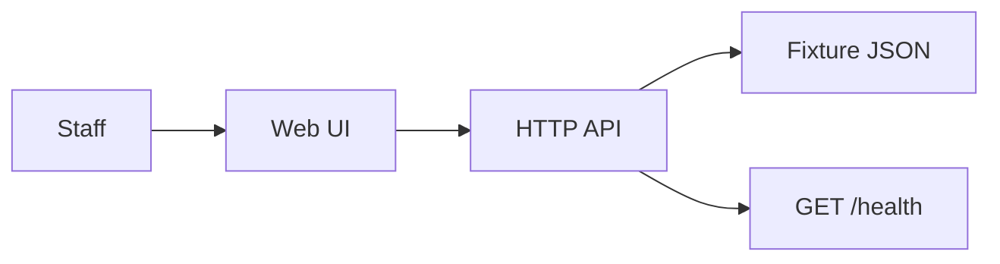
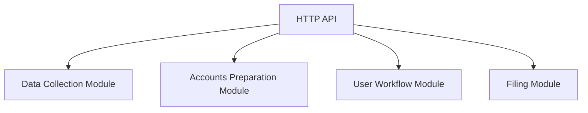
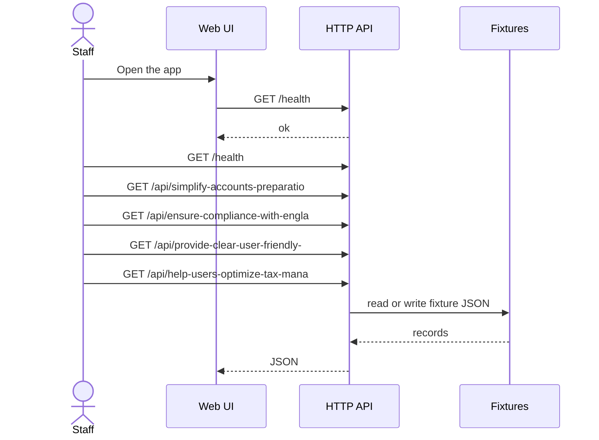

# APPLICAT-1 — Application to Prepare and File Accounts for Small Limited Companies in England

## Intent
Problem
It is for small limited Companies registered in England.
Who it is for
Farm and packhouse teams
What version one does
Ideas is we need an application which can Prepare accounts of a limited company as per England HMRC rules and make them ready to file.
In scope
Guided data collection including bank transactions and other inputs.
Preparation of draft and final accounts as per HMRC requirements.
User review and approval workflow for final accounts.
Electronic filing of returns following HMRC procedures.
Out of scope
Accounting services for companies outside England.
Manual bookkeeping or bank transaction processing.
Tax advice beyond general efficiency suggestions.
Support for complex corporate structures or audits.

This file is the approved architecture. Code is written from this document. Revise it until you approve.

## Ticket comments
- Sesh A: APPLICAT-1 is code review. Project folder written at /app/data/delivery-workspaces/aFi6jouc14PW using Azure OpenAI. Open the workbench, then proceed for testing.
- Sesh A: APPLICAT-1 is deploy approval. operator skipped the test bar. Waiting for deploy approval.
- Sesh A: APPLICAT-1 is completed. Deploy is approved. Open Connections, then Pipeline — attach that connection, set Infra to Use existing, and Run pipeline. Shipdeck will not create a new cloud until you choose.
- Sesh A: APPLICAT-1 is architecture review. Live usage this call: 1324 tokens
- Sesh A: APPLICAT-1 is writing code. Now: calling Azure OpenAI to write the project files. This can take a minute.
- Sesh A: APPLICAT-1 is code review. Project folder written at /app/data/delivery-workspaces/3DXOC2CEQvRj using Azure OpenAI. Open the workbench, then proceed for testing.
- Sesh A: APPLICAT-1 is deploy approval. operator skipped the test bar. Waiting for deploy approval.
- Sesh A: APPLICAT-1 is completed. Deploy is approved. Open Connections, then Pipeline — attach that connection, set Infra to Use existing, and Run pipeline. Shipdeck will not create a new cloud until you choose.

## System context

## Components

- **Data Collection Module** (node) — Guided data collection including bank transactions and other inputs
- **Accounts Preparation Module** (python) — Preparation of draft and final accounts as per HMRC requirements
- **User Workflow Module** (node) — User review and approval workflow for final accounts
- **Filing Module** (python) — Electronic filing of returns following HMRC procedures
- **Fixture store** — JSON under `fixtures/`. No production database.

## APIs

| Method | Path | Purpose |
| --- | --- | --- |
| GET | `/health` | Deploy verify — report ok |
| GET | `/api/simplify-accounts-preparatio` | Simplify accounts preparation for small limited companies. |
| GET | `/api/ensure-compliance-with-engla` | Ensure compliance with England HMRC accounting and filing standards. |
| GET | `/api/provide-clear-user-friendly-` | Provide clear, user-friendly guidance throughout the process. |
| GET | `/api/help-users-optimize-tax-mana` | Help users optimize tax management efficiently. |

## Request flow

## Technologies
- node
- python

After approval, the change stays inside this repository. Languages: node, python. Packages: https://registry.npmjs.org, https://pypi.org. License: MIT, Apache-2.0, BSD-3-Clause.

## In scope
- Simplify accounts preparation for small limited companies.
- Ensure compliance with England HMRC accounting and filing standards.
- Provide clear, user-friendly guidance throughout the process.
- Help users optimize tax management efficiently.

## Out of scope
- Production data access
- Work outside this ticket
- A pull request unless auto-open is enabled

## Assumptions
- The application targets only small limited companies registered in England.
- Users are primarily farm and packhouse teams requiring simplified accounts preparation.
- Existing infrastructure and pipelines will be used for deployment.
- Compliance with HMRC rules is mandatory for accounts preparation and filing.
- Standard platform policies apply including fixture data, GET /health endpoint, linting, unit and integration tests.

## Deploy
After lint, unit, and integration, and after deploy approval, pick Git and a cloud, then run the pipeline. Target **dev**. Rollback owner: **Platform on-call**.

## Planner notes
## Architecture Overview

The application will have a modular architecture with components for data collection, accounts preparation, user workflow management, and electronic filing. It will integrate with HMRC electronic filing systems and provide a user-friendly interface tailored for small limited companies in England.

### Components
- Data Collection Module: Handles guided input of financial data including bank transactions.
- Accounts Preparation Module: Prepares draft and final accounts compliant with HMRC rules.
- User Workflow Module: Manages review and approval processes.
- Filing Module: Manages electronic submission of accounts to HMRC.

### Deployment
The app will be deployed using existing infrastructure with pipelines configured for continuous integration and deployment.

### Compliance
Ensures all accounts and filings meet England HMRC standards for small limited companies.

